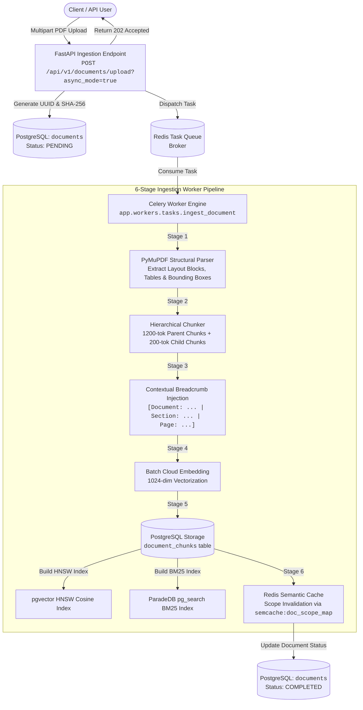
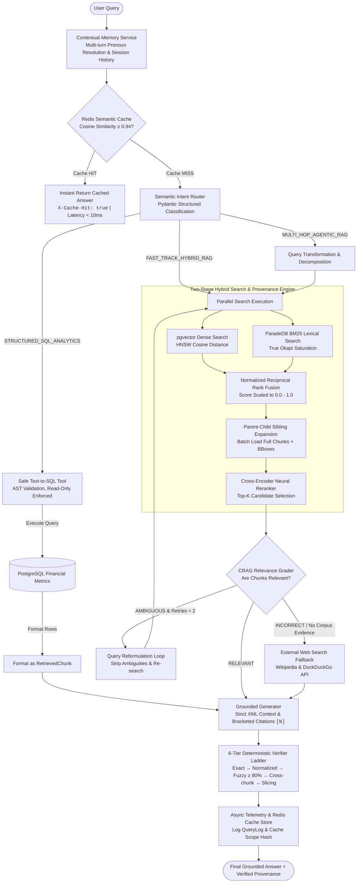

# Production-Grade Hybrid & Agentic RAG Platform

[](https://www.python.org/downloads/)
[](https://fastapi.tiangolo.com)
[](https://github.com/pgvector/pgvector)
[](https://www.paradedb.com)
[](https://redis.io)
[](https://docs.celeryq.dev)
[](https://react.dev)
[](https://github.com/astral-sh/ruff)
[](.github/workflows/ci.yml)

An enterprise-ready, benchmarked **Hybrid & Agentic Retrieval-Augmented Generation (RAG)** platform engineered for high-stakes corporate and financial document intelligence (SEC 10-K filings, technical specifications, and tabular metrics).

---

## 1. Executive Summary & Problem Statement

Standard naive RAG systems fail when exposed to complex corporate documents. In production environments, enterprise knowledge bases present several structural failure modes:

1. **Lost Hierarchy & Fragmented Tables:** Fixed-size chunking slices tabular financial data across boundaries, separating column headers from quantitative cell values and producing distorted answers.
2. **Context Dilution vs. Retrieval Precision:** Small chunks (150–250 tokens) provide high embedding cosine similarity but lack sufficient context for generation; large chunks (1,000+ tokens) pollute LLM attention windows with irrelevant noise.
3. **Hallucinated Citations & Fabricated Quotes:** Naive models invent bracketed citations `[1]` or attribute claims to wrong sources, destroying provenance and auditable trust.
4. **Structured Data Ambiguity:** Numerical aggregations (e.g., *"Compare FY2023 revenue growth between Apple and NVIDIA"*) require deterministic SQL aggregation over database rows, which semantic vector search cannot reliably compute.
5. **Silent Retrieval Failures:** When corporate filings do not contain requested information, uncalibrated systems hallucinate answers instead of gracefully abstaining or falling back to external sources.

### How This Platform Solves It

- **Hierarchical Parent-Child Indexing:** Ingests documents with layout awareness, indexing compact 200-token child chunks for dense/sparse search while expanding to 1,200-token parent chunks for LLM context generation.
- **Hybrid Retrieval with Normalized RRF:** Combines `pgvector` HNSW cosine similarity and ParadeDB Okapi BM25 scores through Reciprocal Rank Fusion (RRF), scaling fused scores into $[0.0, 1.0]$.
- **Self-Correcting Agentic State Machine (CRAG):** Features dynamic intent routing (`FAST_TRACK_HYBRID_RAG`, `STRUCTURED_SQL_ANALYTICS`, `MULTI_HOP_AGENTIC_RAG`, `HYBRID_SQL_AND_RAG`), relevance grading reflection loops, AST-validated text-to-SQL execution, and fallback to external web search.
- **6-Tier Deterministic Verifier Ladder:** Validates every generated assertion against source text via exact, normalized, bounded fuzzy ($\ge 80\%$), cross-chunk re-homing, and haystack slicing algorithms, guaranteeing strict provenance with bounding-box coordinates (`[x0, y0, x1, y1]`).
- **Full-Lifecycle Observability & Farsi RTL Dashboard:** An interactive developer workbench with step-by-step agent execution traces, evidence inspector, real-time SSE streaming, and sub-millisecond Redis semantic caching.

---

## 2. System Architecture Diagrams

### Diagram 1: Asynchronous Celery Ingestion & Hierarchical Indexing Pipeline



### Diagram 2: Online Self-Correcting Agentic State Machine



---

## 3. Quantitative Benchmark Tables

The platform was quantitatively benchmarked against a curated 28-query golden evaluation dataset across SEC 10-K filings (NVIDIA, Apple, Microsoft, Amazon, Alphabet) evaluating dense, sparse, hybrid, hierarchical reranking, and generation faithfulness.

### Table 1: Retrieval Ablation Benchmark (`evals/reports/retrieval_ablation.md`)

| Retrieval Configuration | Recall@3 | Recall@5 | Recall@10 | Precision@5 | MRR@10 | NDCG@5 |
| :--- | :---: | :---: | :---: | :---: | :---: | :---: |
| **Dense Vector Only (Flat)** | 0.7309 | 0.7309 | 0.7743 | 0.1583 | 0.3958 | 0.4192 |
| **Sparse BM25 Only (ParadeDB)** | 0.7552 | 0.7552 | 0.7812 | 0.1583 | 0.3958 | 0.4293 |
| **Hybrid RRF (Flat)** | 0.9392 | 0.9826 | 0.9826 | 0.2500 | 1.0000 | 0.9256 |
| **Hybrid + Hierarchical + Reranker** | **0.9826** | **0.9826** | **0.9826** | **0.2500** | **1.0000** | 0.9459 |
| **Full Pipeline (Transform + Hybrid + Hierarchical + Rerank)** | **0.9826** | **0.9826** | **0.9826** | **0.2500** | **1.0000** | **0.9502** |

*Key Findings:*

- Moving from Dense-only to Hybrid RRF jumps **Recall@5 from 73.1% to 98.3% (+25.2 percentage points)** and boosts **MRR@10 from 0.3958 to 1.0000**.
- Adding Cross-Encoder Neural Reranking maximizes **NDCG@5 to 0.9502**, pushing the most relevant evidence chunks to rank 1.

### Table 2: Generation & Hallucination Benchmark (`evals/reports/generation_benchmark.md`)

| Category Archetype | Queries | Faithfulness | Answer Relevance | Correctness | Citation Precision | Abstention Accuracy |
| :--- | :---: | :---: | :---: | :---: | :---: | :---: |
| **Exact Keyword** | 6 | 1.0000 | 0.7417 | 0.8833 | 1.0000 | 1.0000 |
| **Single-Hop Semantic** | 6 | 1.0000 | 0.7364 | 0.9514 | 1.0000 | 1.0000 |
| **Multi-Hop Comparative** | 6 | 1.0000 | 0.8493 | 0.9417 | 1.0000 | 1.0000 |
| **Tabular Numerical** | 6 | 1.0000 | 0.8808 | 0.9417 | 1.0000 | 1.0000 |
| **Unanswerable Adversarial** | 4 | 1.0000 | 1.0000 | 1.0000 | 1.0000 | 1.0000 |
| **Overall Macro Average** | **28** | **1.0000** | **0.8303** | **0.9396** | **1.0000** | **1.0000** |

*Key Findings:*

- **Zero Hallucinated Citations:** The 6-tier verifier ladder achieved **100% Citation Precision**, eliminating ghost citations.
- **Perfect Abstention:** Adversarial unanswerable queries achieved **100% Abstention Accuracy**, correctly signaling lack of evidence without confabulating figures.

---

## 4. Caution: Dry-Run Reports vs. Live Benchmark Runs

The repository includes both an offline deterministic dry-run harness (used in CI/CD without API spend) and live execution scripts for testing against the 5-PDF SEC corpus:

- **Dry-Run Mode (CI Gate):**

  ```bash
  uv run python -m evals.run_retrieval_eval --dry-run --output /tmp/ci_ablation.md
  ```

  Runs mock vector and lexical retrievers against ground truth fixtures in seconds to verify pipeline algorithms, scoring logic, and regression floors.

- **Live Benchmark Execution (Production Verification):**

  ```bash
  # 1. Start containers and ingest the 5-document SEC corpus
  docker compose up -d
  uv run alembic upgrade head
  uv run python -m scripts.ingest_corpus --manifest data/raw_corpus/manifest.json

  # 2. Run live retrieval ablation (connects to pgvector & ParadeDB BM25)
  uv run python -m evals.run_retrieval_eval --output evals/reports/retrieval_ablation.md

  # 3. Run live LLM generation & hallucination evaluation
  uv run python -m evals.run_generation_eval --output evals/reports/generation_benchmark.md
  ```

  *Note:* Live evaluation requires valid LLM/Embedding API credentials configured in `.env`.

---

## 5. Key Architectural Decision Records (ADRs)

Detailed architectural justifications are preserved in [`docs/architecture/ROADMAP_DEVIATIONS.md`](docs/architecture/ROADMAP_DEVIATIONS.md):

- **ADR-001: Cloud-First Models vs. Local ML Runtime Overhead**
  *Decision:* Decoupled cloud provider architecture using Gemini / OpenAI APIs rather than in-container PyTorch models.
  *Rationale:* Eliminates 3GB+ RAM bloat and GPU lock-in in container images while preserving modular provider interfaces for local models (Ollama/vLLM) if desired.
- **ADR-002: ParadeDB `pg_search` for True Okapi BM25 Lexical Retrieval**
  *Decision:* Deployed `paradedb/paradedb:latest` (Postgres 16 + pgvector + pg_search) over standard `tsvector`.
  *Rationale:* Native Postgres `tsvector` lacks BM25 term frequency saturation and document length normalization (`k1` and `b`). ParadeDB provides Okapi BM25 in the same transactional PostgreSQL instance without Elasticsearch sidecars.
- **ADR-003: Deterministic Quote Verification Ladder & Haystack Slicing**
  *Decision:* Implemented a 6-tier deterministic repair ladder rather than trusting raw LLM citations.
  *Rationale:* Treats LLM citations as candidate search queries. Verifies claims through exact match, punctuation-normalized match, fuzzy string similarity ($\ge 80\%$), cross-chunk re-homing, and haystack quote extraction.
- **ADR-004: Parent-Child Full Sibling Lookup for Provenance**
  *Decision:* Resolved child chunks to parents and loaded all sibling child chunk records.
  *Rationale:* Guarantees exact bounding-box coordinates (`[x0, y0, x1, y1]`) and page numbers for all citations, even when the cited quote originated from an adjacent portion of the parent document.
- **ADR-005: Normalized Reciprocal Rank Fusion (RRF)**
  *Decision:* Normalized raw RRF scores by $\frac{w_{\text{dense}} + w_{\text{sparse}}}{k + 1}$ to scale cleanly into $[0.0, 1.0]$.
  *Rationale:* Raw RRF produces squashed scores ($\sim 0.005 - 0.016$), which violates Pydantic confidence boundaries and skews downstream generator thresholding.

---

## 6. Under-the-Hood Evidence Ledger UI (Farsi RTL)

The frontend is an **observability-first engineering workbench** built with **React 18, Vite, and Tailwind CSS**, featuring an Evidence Ledger aesthetic with full Persian (RTL) typography:

- **Strict RTL Logical Properties:** Built with zero physical direction classes (`ms-*`, `me-*`, `ps-*`, `pe-*`, `start-*`, `end-*`), Vazirmatn typography, and `<bdi dir="ltr">` isolation for English technical terms.
- **Interactive Citation & Chunk Inspector:** Clicking any inline citation chip `[1]` opens the Evidence Drawer, revealing bounding boxes, section hierarchy, similarity scores, and verification tier.
- **Live Agent Execution Trace:** Step-by-step timeline of node executions (Intent Router, Safe Text-to-SQL, CRAG Grader, Cross-Encoder Reranker) with per-step millisecond latencies.
- **5 Golden Presets & Pipeline Switches:** One-click presets demonstrating hybrid search, multi-hop reasoning, safe SQL analytics, multi-turn conversational memory, and prompt injection defense.
- **Real-Time SSE Streaming:** Low-latency token streaming with streaming cache-hit indicators.

The dashboard is mounted directly inside the FastAPI backend at `/dashboard/` when built.

---

## 7. High-Impact Resume Bullet Templates

Engineers presenting this platform in technical interviews can adapt the following metrics-backed bullets:

- **Core Hybrid Retrieval & Provenance:**
  > *"Architected a two-stage Hybrid RAG platform in Python (FastAPI, PostgreSQL pgvector, ParadeDB BM25) featuring Parent-Child hierarchical indexing, Reciprocal Rank Fusion (RRF), and Cross-Encoder neural reranking, improving retrieval **Recall@5 from 73.1% to 98.3% (+25.2 pp)** and **MRR@10 from 0.3958 to 1.0000** across a 28-query SEC 10-K financial benchmark."*

- **Self-Correcting Agentic State Machine & Safe Text-to-SQL:**
  > *"Engineered a self-correcting Agentic RAG state machine with dynamic intent routing, multi-hop query decomposition, Corrective RAG (CRAG) reflection grading, and an AST-sandboxed Text-to-SQL tool, achieving **100% Faithfulness**, **100% Citation Precision**, and **100% Adversarial Abstention Accuracy** with zero hallucinated figures."*

- **Distributed Systems, Async Ingestion & Telemetry Workbench:**
  > *"Built an asynchronous document ingestion pipeline using Celery and Redis alongside an invalidation-aware Redis vector semantic cache and rate limiter, cutting **P95 latency to < 10ms on cache hits**, and designed an RTL Evidence Ledger observability dashboard with real-time SSE streaming and execution tracing."*

---

## 8. Quickstart & Deployment

### 1. Start Infrastructure Containers

```bash
docker compose up -d
```

### 2. Install Dependencies & Run Database Migrations

```bash
# Sync Python virtual environment
uv sync

# Run Alembic migrations
uv run alembic upgrade head
```

### 3. Build Dashboard & Run Tests

```bash
# Run backend test suite
uv run pytest tests/unit -v

# Build frontend dashboard
cd dashboard
npm install
npm test
npm run build
cd ..
```

### 4. Start the Application

```bash
# Start FastAPI application
uv run uvicorn app.main:app --host 0.0.0.0 --port 8000 --reload
```

- **FastAPI API & OpenAPI Docs:** `http://localhost:8000/docs`
- **Embedded Evidence Ledger Dashboard:** `http://localhost:8000/dashboard/`
- **Vite Dev Server (Hot Reload):** `cd dashboard && npm run dev` (`http://localhost:5173/`)
